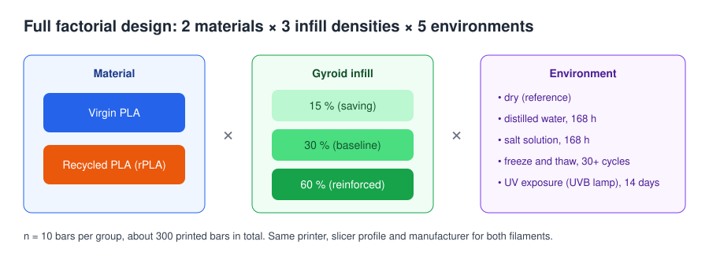
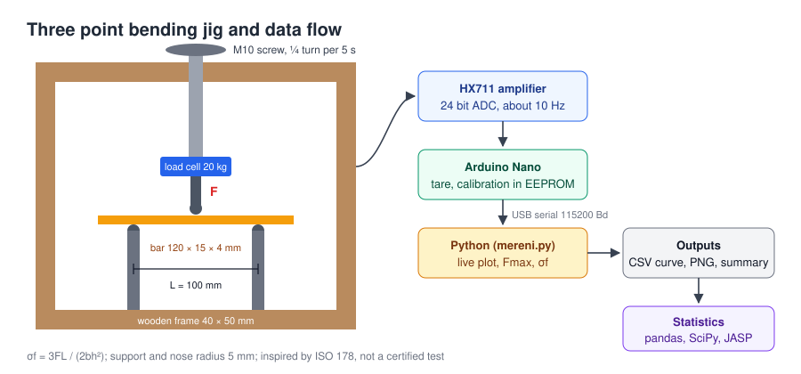

# Recyklované vs. virgin PLA: nízkonákladové zkoušení pevnosti 3D výtisků

[English version](README.md)

Projekt diplomové práce na České zemědělské univerzitě v Praze (ČZU), Provozně ekonomická fakulta.
Název práce: *Analýza nastavení a možností 3D tisku s ohledem na úsporu materiálu a času.*
Stav: **experimentální část dokončena, práce se dopisuje (obhajoba plánována na únor 2027).**

## Shrnutí

Projekt řeší praktickou otázku: **může uživatel 3D tiskárny ušetřit filament, čas tisku a peníze přechodem na recyklované PLA a snížením hustoty výplně, aniž by výrazně ztratil pevnost, a to i v případě, že výtisk skončí ve vodě, soli, mrazu nebo na slunci?**

Bez přístupu do materiálové laboratoře jsem zvolil nízkonákladový přístup („guerilla science“):

* navrhl jsem úplný faktoriální experiment s přibližně 300 tištěnými zkušebními tyčkami,
* postavil jsem vlastní tříbodový ohybový přípravek se siloměrem (tenzometr, HX711, Arduino Nano),
* připravil jsem firmware a skript v Pythonu, který zaznamenává průběh síly, počítá maximální sílu a pevnost v ohybu a ukládá vše do CSV,
* vzorky jsem doma vystavil prostředím (destilovaná voda, solný roztok, cykly mrazu a tání, UV lampa),
* data jsem statisticky zpracoval v Pythonu (pandas, SciPy, statsmodels) a v programu JASP.

Repozitář obsahuje **metodiku, popis přípravku a zdrojový kód**. Naměřená data a výsledky zveřejním až po obhajobě práce.

## Návrh experimentu



| Faktor | Úrovně |
|---|---|
| Materiál | Virgin PLA, 100% recyklované PLA (rPLA); oba od stejného českého výrobce (Filament PM) |
| Hustota výplně (Gyroid) | 15 %, 30 % (výchozí), 60 % |
| Prostředí | suchý stav, destilovaná voda 168 h, solný roztok 168 h, mráz a tání ve vodě (přes 30 cyklů), UV záření 14 dní |
| Opakování | n = 10 tyček na skupinu |

Sledované veličiny: maximální síla *F*max, pevnost v ohybu σf, hmotnost vzorku a nasákavost, spotřeba filamentu a čas tisku ze sliceru, typ porušení (úplný lom, částečný lom, bez lomu).

### Vzorky

* Tyčka 120 × 15 × 4 mm, model v Blenderu, inspirováno normou ČSN EN ISO 178 (normová tyčka má 80 × 10 × 4 mm).
* Bambu Studio, profil *0.20 mm Standard @BBL A1*, 3 stěny, 4 horní a 4 spodní vrstvy, výplň Gyroid, ostatní nastavení výchozí, pro oba materiály stejné.
* Tisk naplocho, na podložce vždy jen jeden materiál.

## Zkušební přípravek



| Část | Popis |
|---|---|
| Rám | dřevěné hranoly 40 × 50 mm |
| Zatěžování | šroub M10 otáčený ručně, čtvrt otáčky každých 5 s (signalizováno pípnutím), asi 4,5 mm/min, což odpovídá přibližně 1 %/min deformace jako v ISO 178 |
| Podpěry a trn | tištěné držáky se šrouby M10, poloměr 5 mm, rozpětí 100 mm |
| Siloměr | tenzometr 20 kg (YZC 131) se zesilovačem HX711 (24 bit), přibližně 10 vzorků za sekundu |
| Řídicí jednotka | Arduino Nano, kalibrační faktor uložený v EEPROM |
| Počítač | skript v Pythonu na Windows, živý graf v matplotlib |

Zapojení: HX711 `DT → D3`, `SCK → D2`, `VCC → 5V`, `GND → GND`.

Pevnost v ohybu se počítá ze vztahu

```
σf = 3 · F · L / (2 · b · h²)      L = 100 mm, b = šířka, h = tloušťka
```

## Struktura repozitáře

```
firmware/ohybova_zkouska/ohybova_zkouska.ino   firmware pro Arduino (tara, kalibrace, výstup síly)
software/mereni.py                             záznam jedné ohybové zkoušky v Pythonu
software/requirements.txt                      knihovny pro Python
docs/img/                                      schémata
```

## Použití

### Firmware

1. Ve Správci knihoven nainstalovat *HX711 Arduino Library* (Bogdan Necula).
2. Nahrát `ohybova_zkouska.ino` do Arduina Nano.
3. V Sériovém monitoru (115200 Bd, konec řádku Newline): `t` tara, `c` kalibrace referenčním závažím, `c 500` kalibrace závažím 500 g, `f` výpis kalibračního faktoru.

Arduino poté posílá řádky `cas_ms,sila_g,sila_N`.

### Skript pro záznam

```
py -m pip install -r software/requirements.txt
py software/mereni.py VZOREK_ID SIRKA_mm TLOUSTKA_mm HMOTNOST_g [PORT] [--bez-grafu]
# příklad
py software/mereni.py PLA_30_01 15.02 4.05 7.4
```

Postup: tara se zvednutým trnem, přípravná fáze s živým zobrazením síly, záznam s pípnutím každých 5 s, po lomu obsluha ukončí záznam a zvolí typ porušení.

Výstupy ve složce `software/data/`:

* `VZOREK_ID.csv`: nahoře údaje o vzorku a výsledky, pod nimi celý průběh síly,
* `VZOREK_ID.png`: graf průběhu síly s vyznačeným maximem,
* `vysledky.csv`: jeden řádek na vzorek, připraveno pro pandas nebo JASP.

Ošetření chyb: automatické nalezení portu Arduina (převodník CH340), kontrola rozsahu vstupů odhalí přehozená čísla, maximální síla se určuje z klouzavého mediánu tří hodnot (jedna chybná hodnota ji neovlivní), čas se bere z hodin Arduina, ne z počítače, skript počká, když je souhrnné CSV otevřené v Excelu, varování při blížícím se rozsahu tenzometru.

## Zpracování dat

Statistické vyhodnocení v Pythonu (pandas, SciPy, statsmodels) s kontrolou v programu JASP, α = 0,05:

* popisná statistika, Grubbsův test odlehlých hodnot,
* Shapirův a Wilkův test normality, Leveneův test,
* Welchův t test virgin vs. recyklát s Holmovou korekcí,
* třífaktorová ANOVA (materiál × výplň × prostředí) s parciálním η², ANOVA na pořadích jako kontrola, Tukey HSD,
* Spearmanova korelace a lineární regrese (vniknutí vody vs. pokles pevnosti),
* Mannův a Whitneyho test a mediány u nasákavosti, která nemá normální rozdělení,
* výpočet úspory materiálu, času a peněz z dat sliceru a cen filamentu.

Skript pro vyhodnocení a anonymizovaná data doplním po obhajobě.

## Omezení metody

Jde o studentský projekt, ne o certifikovanou zkoušku. Přípravek je normou ISO 178 *inspirován*, nesplňuje ji:

* ruční schodovité zatěžování místo konstantní rychlosti příčníku,
* jiný rozměr vzorku a rozpětí podpěr než v normě,
* průhyb se neměří, proto se nevyhodnocuje modul pružnosti v ohybu,
* tenzometr je kalibrován jedním referenčním závažím,
* výsledkem je zdánlivá pevnost tištěné tyčky s danou výplní, ne pevnost samotného materiálu; hodí se pro relativní srovnání skupin,
* domácí stárnutí (UV lampa, mrazák) je zrychlený srovnávací test, ne ekvivalent let venku.

## Použité dovednosti

Návrh experimentu, Python (sběr dat přes sériový port, pandas, SciPy, matplotlib), Arduino a C++, elektronika s tenzometrem a HX711, statistika, 3D modelování v Blenderu, slicování a FDM tisk, technická dokumentace.

Firmware a skript pro záznam vznikly s pomocí AI asistenta; já jsem určil požadavky, postavil a zkalibroval přípravek, kód při měření testoval a upravoval a použil ho pro všechny ohybové zkoušky v práci.

## Autor

Matyáš Vesecký, Česká zemědělská univerzita v Praze, Provozně ekonomická fakulta.
Vedoucí práce: doc. Ing. Jiří Vaněk, Ph.D.

## Licence

Kód je zveřejněn pod licencí [MIT](LICENSE).
