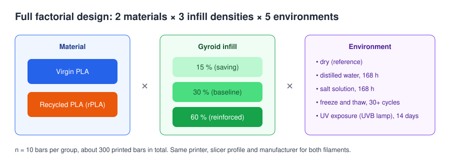
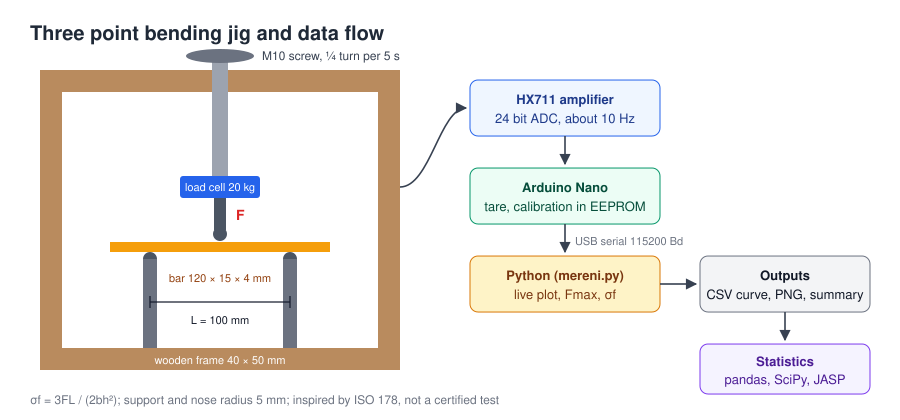

# Recycled vs. virgin PLA: low cost strength testing of 3D printed parts

[Česká verze](README.cs.md)

Master's thesis project at the Czech University of Life Sciences Prague (CZU), Faculty of Economics and Management.
Thesis title: *Analysis of 3D printing settings and options with regard to saving material and time.*
Status: **experimental part finished, thesis in progress (defense planned for February 2027).**

## Summary

The project asks a practical question: **can a hobby or small scale 3D printing user save filament, print time and money by switching to recycled PLA and lowering infill density, without losing too much strength, even when the part ends up in water, salt, frost or sunlight?**

Without access to a materials lab, I followed a low cost ("guerilla science") approach:

* designed a full factorial experiment with about 300 printed test bars,
* built my own instrumented three point bending jig (load cell, HX711, Arduino Nano),
* wrote the firmware and a Python logging tool that records the force curve, computes peak force and flexural strength and stores everything as CSV,
* aged the specimens at home (water, salt solution, freeze and thaw cycles, UV lamp),
* processed the data statistically in Python (pandas, SciPy, statsmodels) and JASP.

This repository contains the **methodology, hardware description and source code**. Measured data and results stay unpublished until the thesis is defended.

## Experiment design



| Factor | Levels |
|---|---|
| Material | Virgin PLA, 100 % recycled PLA (rPLA); both from the same Czech manufacturer (Filament PM) |
| Infill density (Gyroid) | 15 %, 30 % (baseline), 60 % |
| Environment | dry, distilled water 168 h, salt solution 168 h, freeze and thaw in water (30+ cycles), UV exposure 14 days |
| Replicates | n = 10 bars per group |

Measured variables: peak force *F*max, flexural strength σf, specimen mass and water uptake, filament consumption and print time from the slicer, failure type (full break, partial break, no break).

### Specimens

* Bar 120 × 15 × 4 mm, modelled in Blender, inspired by ISO 178 (the standard bar is 80 × 10 × 4 mm).
* Bambu Studio, profile *0.20 mm Standard @BBL A1*, 3 walls, 4 top and 4 bottom layers, Gyroid infill, all other settings default, identical for both materials.
* Printed flat, one material per build plate.

## Test rig



| Part | Description |
|---|---|
| Frame | wooden beams 40 × 50 mm |
| Loading | M10 screw turned by hand, a quarter turn every 5 s (signalled by a beep), about 4.5 mm/min, which corresponds to roughly 1 %/min strain as in ISO 178 |
| Supports and loading nose | 3D printed holders with M10 bolts, radius 5 mm, span 100 mm |
| Force sensor | 20 kg bar load cell (YZC 131) with HX711 24 bit amplifier, about 10 samples per second |
| Controller | Arduino Nano, calibration factor stored in EEPROM |
| PC side | Python script on Windows, live plot in matplotlib |

Wiring: HX711 `DT → D3`, `SCK → D2`, `VCC → 5V`, `GND → GND`.

Flexural strength is computed as

```
σf = 3 · F · L / (2 · b · h²)      L = 100 mm, b = width, h = thickness
```

## Repository structure

```
firmware/ohybova_zkouska/ohybova_zkouska.ino   Arduino firmware (tare, calibration, force stream)
software/mereni.py                             Python logger for one bending test
software/requirements.txt                      Python dependencies
docs/img/                                      diagrams
```

Code comments and console messages are in Czech, since the tool was used during the measurements in Czech.

## Usage

### Firmware

1. Install the *HX711 Arduino Library* (Bogdan Necula) via the Library Manager.
2. Upload `ohybova_zkouska.ino` to the Arduino Nano.
3. In the Serial Monitor (115200 baud, newline): `t` tare, `c` calibrate with the reference weight, `c 500` calibrate with a 500 g weight, `f` print the calibration factor.

The board then streams lines `time_ms,force_g,force_N`.

### Logger

```
pip install -r software/requirements.txt
python software/mereni.py SAMPLE_ID WIDTH_mm THICKNESS_mm MASS_g [PORT] [--bez-grafu]
# example
python software/mereni.py PLA_30_01 15.02 4.05 7.4
```

Workflow: tare with the loading nose lifted, a preparation phase with live force readout, recording with a beep every 5 s, the operator confirms the end of the test after the break and selects the failure type.

Outputs in `software/data/`:

* `SAMPLE_ID.csv`: specimen info and results on top, full force curve below,
* `SAMPLE_ID.png`: force curve with the marked peak,
* `vysledky.csv`: one row per specimen, ready for pandas or JASP.

Robustness features: automatic detection of the Arduino port (CH340), input range checks that catch swapped numbers, peak force taken as the maximum of a 3 point running median (a single noisy sample cannot set it), timestamps from the Arduino clock instead of the PC, waiting when the summary CSV is locked by Excel, overload warnings near the load cell limit.

## Data analysis

Statistical evaluation in Python (pandas, SciPy, statsmodels) with cross checks in JASP, α = 0.05:

* descriptive statistics, Grubbs outlier test,
* Shapiro Wilk normality test, Levene test,
* Welch t test virgin vs. recycled with Holm correction,
* three factor ANOVA (material × infill × environment) with partial η², ANOVA on ranks as a robustness check, Tukey HSD,
* Spearman correlation and linear regression (water ingress vs. strength loss),
* Mann Whitney test and medians for non normal water uptake data,
* material, time and cost savings calculated from slicer data and filament prices.

The evaluation script and anonymised data will be added after the defense.

## Limitations

This is a student project, not a certified test. The rig is *inspired by* ISO 178, it does not comply with it:

* manual stepwise loading instead of a constant crosshead speed,
* different specimen size and span than the standard,
* deflection is not measured, so the flexural modulus is not evaluated,
* load cell calibrated with a single reference weight,
* the result is the apparent strength of a printed bar with a given infill, not the strength of the material itself, which is suitable for relative comparison of groups,
* home ageing (UV lamp, freezer) is an accelerated comparative test, not an equivalent of years outdoors.

## Skills used

Experiment design, Python (data acquisition over serial port, pandas, SciPy, matplotlib), Arduino and C++, electronics with a load cell and HX711, statistics, 3D modelling in Blender, slicing and FDM printing, technical documentation.

The firmware and the logging script were developed with the help of an AI assistant; I specified the requirements, built and calibrated the rig, tested and adjusted the code during the measurements and used it for all bending tests in the thesis.

## Author

Matyáš Vesecký, Czech University of Life Sciences Prague, Faculty of Economics and Management.
Thesis supervisor: doc. Ing. Jiří Vaněk, Ph.D.

## License

Code is released under the [MIT License](LICENSE).
